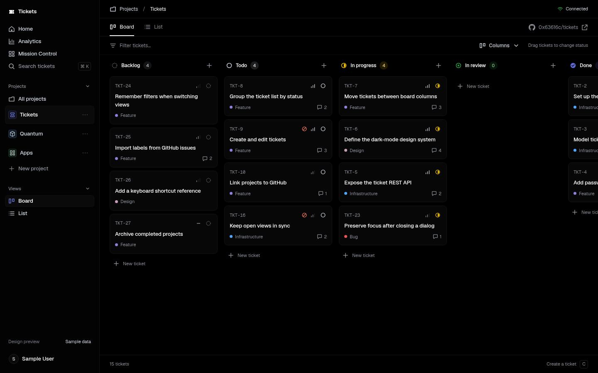
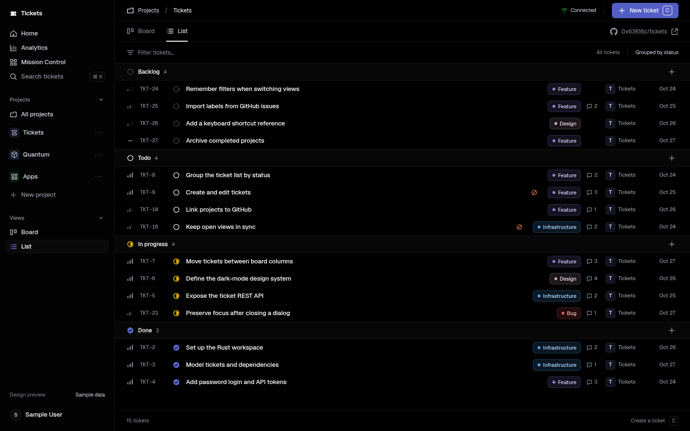
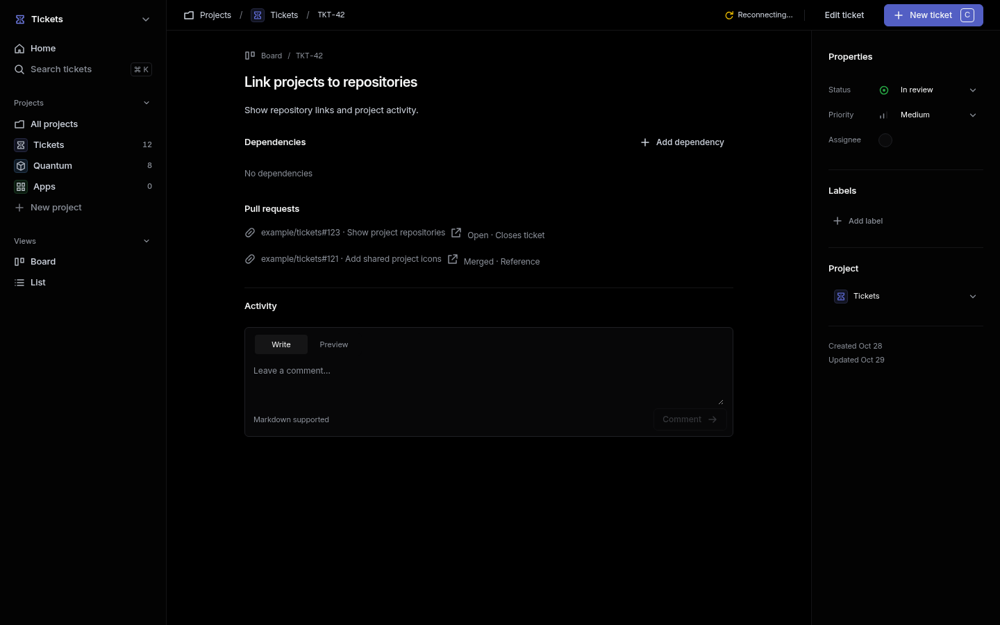
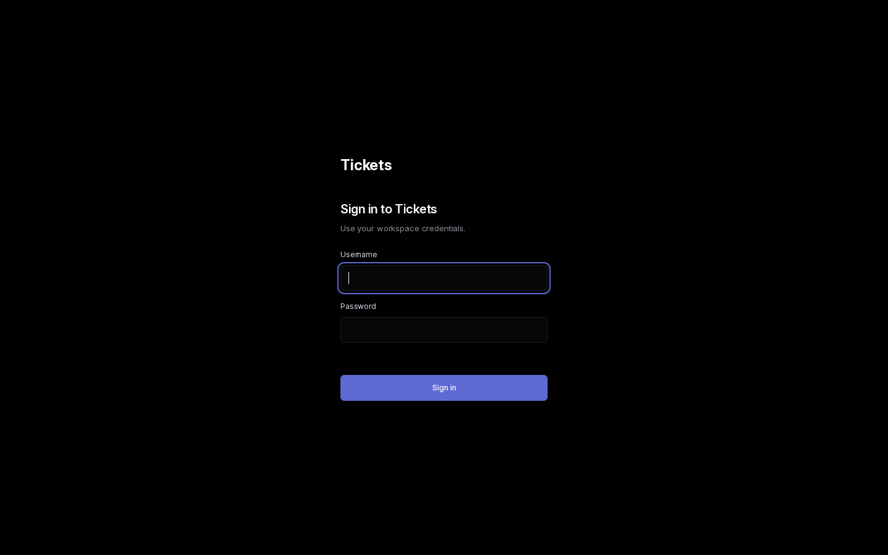
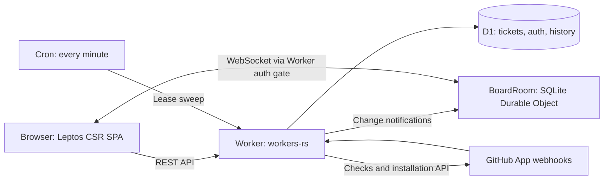

# Tickets

A fast, Linear-style ticket tracker for humans and AI agents, built with Rust
and Cloudflare's edge platform.

[](https://github.com/0x63616c/tickets/actions/workflows/ci.yml)
[](rust-toolchain.toml)
[](docs/SELF-HOSTING.md)
[](#license)



## Features

- Projects, tickets, priorities and labels, with Kanban and list views.
- Dependencies with cycle prevention and derived blocked state.
- Comments, sanitized Markdown and ticket change history.
- Live updates over WebSockets through a SQLite Durable Object.
- REST API and personal API tokens for scripts and agents.
- Ranked claim-next work queue with renewable leases and expiry recovery.
- Mission Control for agent reports, review queues and recent completions.
- GitHub App integration: PR linking, ticket status sync and a Tickets check run.
- One-shot GitHub issue importer that preserves provenance and discussion.
- A repository [agent skill](.agents/skills/tickets/SKILL.md) with executable API examples.

## A closer look

These existing desktop captures show local fixture/demo data in the dark interface.
They illustrate different stages of the UI; no production workspace data is shown.

| List view | Ticket detail | Sign in |
| --- | --- | --- |
|  |  |  |

## Why Tickets?

Work should be easy to inspect, pick up and hand off. Humans use a compact,
keyboard-friendly interface; agents use the same underlying domain through an
explicit API. Dependencies determine what is ready, and leases make ownership
visible. D1 holds authoritative state; live messages tell clients when to refetch.
The interface is deliberately dark only.

## Architecture



| Path | Responsibility |
| --- | --- |
| [`crates/core`](crates/core) | Runtime-independent domain types, validation and shared logic |
| [`crates/worker`](crates/worker) | HTTP API, authentication, D1 adapter, GitHub integration and live rooms |
| [`crates/web`](crates/web) | Leptos CSR application, CSS and Trunk assets |
| [`xtask`](xtask) | Rust CLI for builds, migrations, imports and verification |
| [`migrations`](migrations) | Versioned D1 SQL migrations |

See [architecture and live-update tradeoffs](docs/ARCHITECTURE.md).

## Quickstart

Install [Rust via rustup](https://rustup.rs/) and Node.js 22, then:

```sh
git clone https://github.com/0x63616c/tickets.git
cd tickets
rustup show
cargo install worker-build --version 0.8.7 --locked
cargo install trunk --version 0.21.14 --locked
npm install --global wrangler@4.154.0
cp .dev.vars.example .dev.vars
cargo xtask auth-hash
```

Supply a generated passphrase of at least 16 characters on stdin. Put the emitted
hash and your chosen username in `.dev.vars`, then run:

```sh
cargo xtask migrate
cargo xtask dev
```

Open <http://localhost:8787> and sign in. `cargo xtask dev` installs the locked web
dependencies and builds both frontend and Worker. See [local development](docs/DEVELOPMENT.md)
for authentication, rebuilds, tests and the importer.

## Self-hosting

You need a Cloudflare account, a D1 database and a Worker with a SQLite Durable
Object binding. Tickets uses neither KV nor R2. GitHub integration is optional
and uses your own GitHub App. The [self-hosting guide](docs/SELF-HOSTING.md) covers
provisioning, secrets, domains, CI/CD and values to change when forking.

## API and agents

Create a personal API token in **Settings → API tokens**, then keep `TICKETS_URL`
and `TICKETS_TOKEN` in your secure environment. Use bearer authentication; never
put tokens in URLs. See the [REST API reference](docs/API.md) and
[agent skill](.agents/skills/tickets/SKILL.md) for ticket operations, dependencies,
claim/heartbeat/release and Mission Control reports. Leases are renewable ownership,
not an exactly-once execution guarantee.

## Contributing

Start with [CONTRIBUTING.md](CONTRIBUTING.md) for outside-contributor guidance,
local checks and PR conventions. [AGENTS.md](AGENTS.md) covers repository agent
instructions. Maintainer-instance operations and migration history live in
[the dogfooding notes](docs/DOGFOOD.md) and [deployment notes](docs/DEPLOY.md).

## Security

Report vulnerabilities privately using the process in [SECURITY.md](SECURITY.md).

## License

License: to be decided by the maintainer before the first public release.
