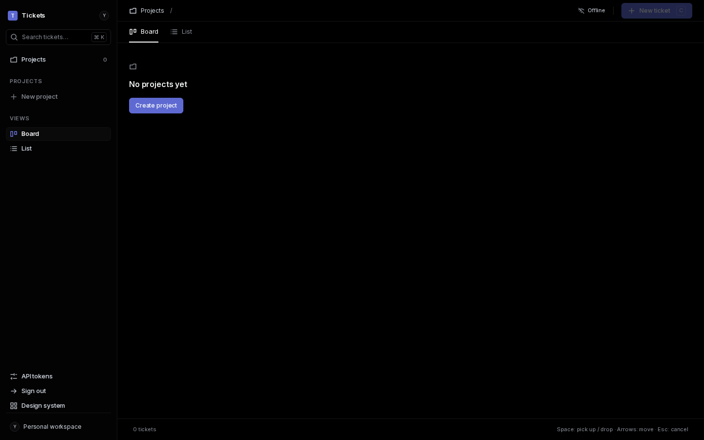
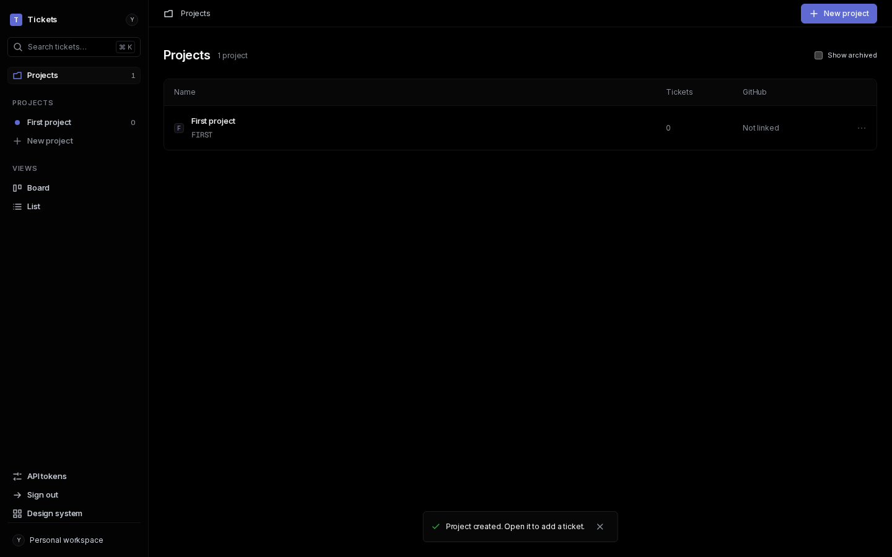
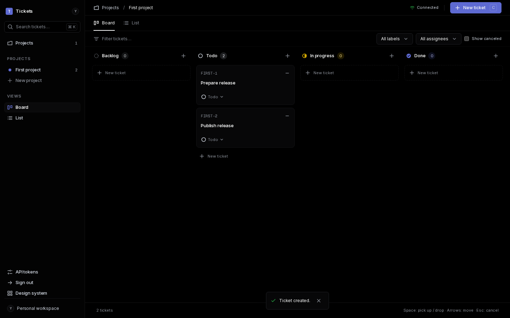
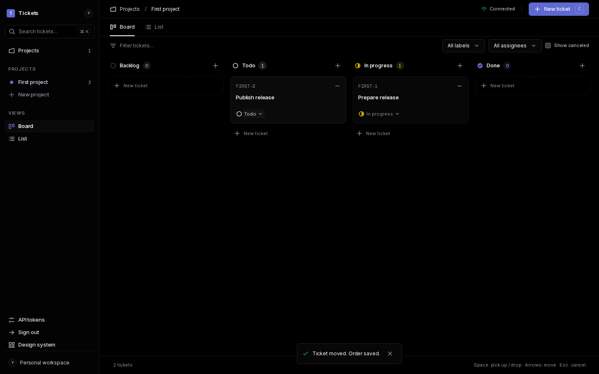
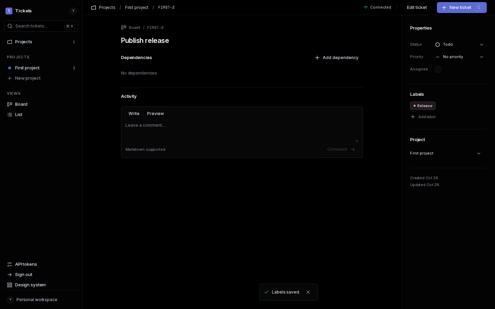
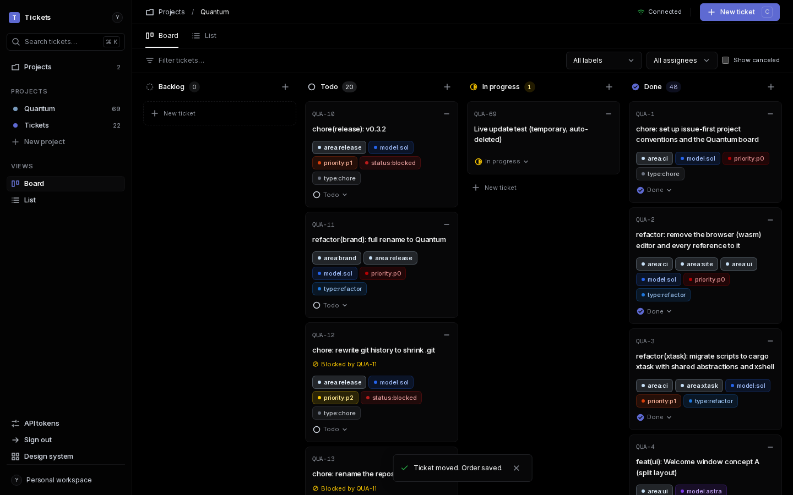
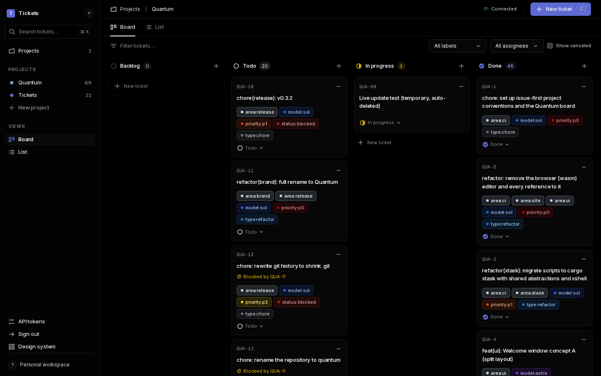

# Tickets v1 verification (#1)

Historical V1 verification snapshot. Since 2026-10-29 Tickets is the sole system
of record; the issue mirror described below is retired. Current migration and
verification instructions live in CONTRIBUTING.md and DEVELOPMENT.md.

Evidence for each item on the v1 spec (#1), recorded on 2026-10-28 against
production (`https://tickets.worldwidewebb.co`) and local `wrangler dev`.

## Child issues

All child issues are closed: #2–#16. Follow-ups found while verifying were
filed and closed too: #32 (near-black theme), #34 (login page), #36 (count
plurals and live catch-up), #38 (favicon), #39 (GitHub mirror), #45 (create
labels from the label menu).

## Primary success criterion: Quantum import

Production import of `0x63616c/voxelite` (#11, PR #37) reconciled with zero
gaps: GitHub 20 open / 48 closed = Tickets 20 / 48, labels 29/29,
dependencies 49/49, comments 37/37. A rerun was idempotent (unique external
ids). These are historical import reconciliation counts, not current totals.
The #39 mirror (PR #46) maintains current counts; GitHub stays primary.

## Dogfooding

Tickets tracks its own issues in the `TIK` project (#12, `docs/DOGFOOD.md`):
import 5 open / 17 closed, labels 6/6, dependencies 24/24, comments 1/1,
gaps 0. These are historical import counts; current totals are maintained by
the #39 mirror.

## First-time user flow

`CHROME_BIN=<headless-chromium> cargo xtask first-run-check` builds the app, applies
all migrations to fresh local D1 with zero data, and logs in through `/login`
using generated local bootstrap credentials. It follows visible links and
buttons to create a project and two tickets, moves the first ticket from Todo
to In progress using the card's status select, creates and attaches a Release
label from the empty label menu, and makes Publish release blocked by Prepare
release. DOM assertions check every result, including Blocks on the first
ticket and Blocked by on the second after following their relationship links.
There is no API seeding, fetch injection, token creation or direct navigation
after login. The existing `projects-check` is a separate seeded regression
check and does not establish this criterion. No UI changes were needed.

| Empty install | Project created |
| --- | --- |
|  |  |

| Two tickets | Kanban move |
| --- | --- |
|  |  |

| Label created and attached | Dependency attached |
| --- | --- |
|  |  |

## Live updates: two-window production test

Two separate logged-in browser sessions (A and B) on the production board,
with a temporary ticket created and deleted through the API:

| Step | Result |
| --- | --- |
| API creates a ticket | Appeared in A and B without reload in 1.3 s |
| A moves it to In progress | B updated live in 1.1 s |
| B goes offline, A moves it to Done | B kept showing In progress (missed update) |
| B comes back online | B caught up to Done in 10.9 s and showed Connected |
| API deletes the ticket | Removed from A and B in 1.7 s |

| Window A | Window B |
| --- | --- |
|  |  |

## Quality gates

Every PR runs fmt, clippy `-D warnings` (native and wasm32), tests,
migrations from zero and gitleaks on GitHub-hosted runners with SHA-pinned
actions. Every merge to main deploys through the `production` environment.
