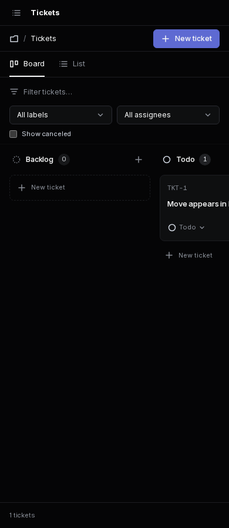
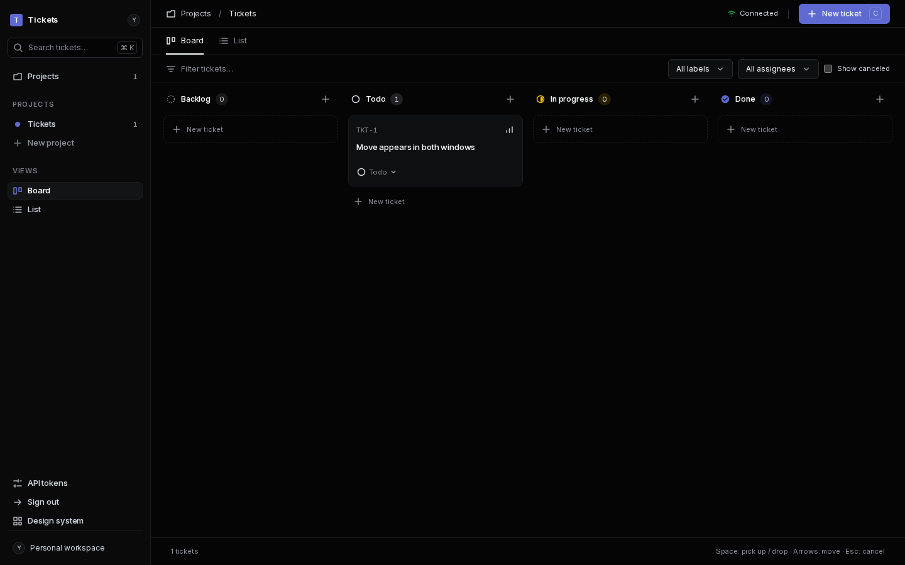
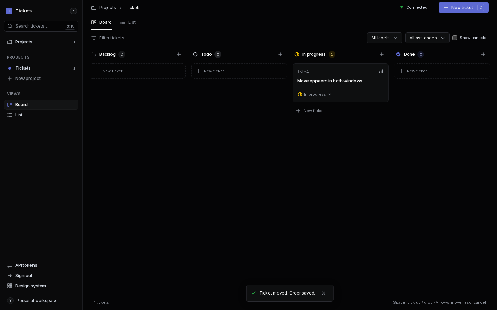
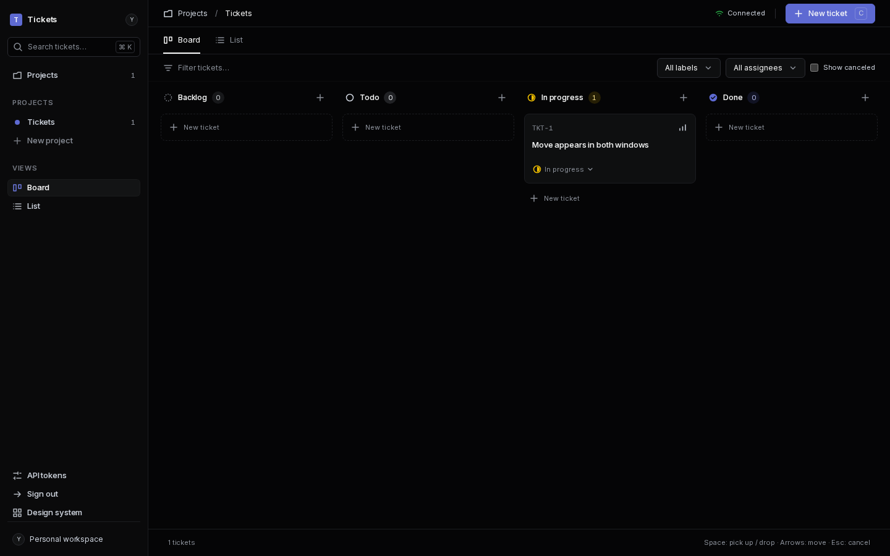

# Issue 16: live updates

All images use local Wrangler/D1, dark mode, loaded bundled fonts and 1440×900
(or 390×900 for mobile). The before images show the real `/` route using assets
built from `origin/main` at `6e9db7b` in a temporary worktree, since removed.
The branch backend supplies the same seed for both captures: one Tickets project
and one Todo ticket, priority High. `board-target-desktop.png` is the separate
`/design/board` fixture reference, not a before image.

Run with `CHROME_BIN=<headless Chromium> cargo xtask live-check`; baseline mode
uses `TICKETS_BEFORE_ASSETS=<main assets>`. Generated local credentials and profiles
remain under ignored `target/`. No production access or deployment is involved.

## Real route

| Viewport | Before (main) | After |
| --- | --- | --- |
| Desktop |  |  |
| Mobile |  |  |

## Two-window demo sequence

Two separate Chromium processes and profiles authenticate independently and open
the same project. Both show Connected. Window A changes the card's status using
the native select; window B receives the project event and reconciles without a
reload. The card moves from Todo to In progress in both windows.

| Step | Window A | Window B |
| --- | --- | --- |
| 1. Before move |  |  |
| 2. After move |  |  |

The same check verifies two native WebSocket clients receive a PATCH invalidation,
401 without credentials, live list/detail updates and reconciliation after an
offline interval. Scope, rejected writes, cross-project moves, comments and
dependencies have additional SQLite route regression tests.
